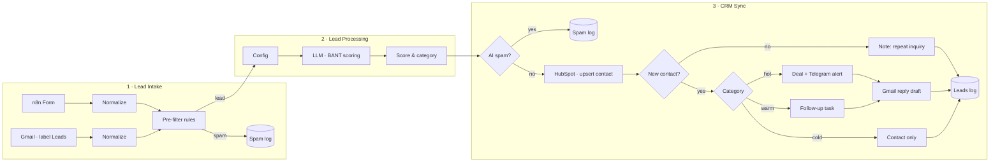

# AI Lead Qualification → HubSpot CRM (n8n)

An automated inbound lead pipeline built with n8n. Leads arrive from a web form and a Gmail inbox. Obvious spam is filtered out for free, then AI scores each lead with the BANT framework, and the lead lands in HubSpot with the right next step:

- **hot** leads get a deal and an instant Telegram alert
- **warm** leads get a follow-up task
- **cold** leads are saved as a clean CRM record

For hot and warm leads, a reply draft is waiting in Gmail, ready to review and send. Every lead is logged in Google Sheets.


---

## What it does

- **Two lead sources, one format.** The n8n Form and Gmail (label `Leads`) are normalized into the same object, so everything after that is built only once.
- **Free spam pre-filter.** Invalid emails, disposable domains, very short messages, no-reply senders and your own address are dropped **before** any AI call.
- **AI qualification (BANT).** An LLM scores Budget, Authority, Need and Timeline with a strict rubric of fixed values and gives evidence for every score. It also extracts the company name and writes a short summary, a next action, and a reply draft in the lead's language.
- **Deterministic routing.** The final category is calculated in code, not by the AI. A lead with red flags or no budget can never be `hot`, so a human checks it first.
- **HubSpot without duplicates.** The contact is created or updated by email. A repeat inquiry becomes a note on the contact's timeline instead of a second deal.
- **Logging.** Real leads go to the `Leads log` sheet. Spam goes to a separate sheet together with the reason it was filtered.
- **Reliability.** Every external API call has retries, and an error workflow sends any failure to Telegram.

---

## Architecture



The system is split into four workflows. Each one has a single job:

| Workflow | Job |
|---|---|
| **1. Lead Intake** | Receives leads from the form and Gmail, normalizes them, drops obvious spam |
| **2. Lead Processing** | AI scoring with the BANT rubric and the settings from the Config node |
| **3. CRM Sync** | Writes to HubSpot and runs the actions for each category |
| **4. Error Handler** | Sends any error from the other workflows to Telegram |

---

## Scoring

| Criterion | Points |
|---|---|
| **Budget** | 30 = at least 3× the minimum budget · 15 = at or above the minimum, or not stated but a real business · 0 = below the minimum, free work, student project |
| **Authority** | 20 = founder, owner or manager who decides · 10 = employee who will pass it on · 0 = unknown |
| **Need** | 30 = a specific problem that matches our services · 15 = vague interest · 0 = not related |
| **Timeline** | 20 = within 30 days · 10 = within 1–3 months · 0 = later or no date |

The total score is 0–100.

| Category | Rule |
|---|---|
| `hot` | 70 or more, with no red flags and a budget score above 0 |
| `warm` | 40–69, or a hot score with red flags or no budget |
| `cold` | below 40 |
| `spam` | AI found ads, SEO offers, job applications, newsletters or nonsense |

Both thresholds are set in the Config node.

**Stable results.** The rubric uses fixed values only, the prompt includes today's date so deadlines are judged correctly, and the AI writes its evidence before each score. Running the same lead again returns the same score.

---

## Actions by category

| Category | HubSpot | Telegram | Gmail | Google Sheets |
|---|---|---|---|---|
| hot | contact + deal in *Qualified To Buy* | instant alert | reply draft | Leads log |
| warm | contact + follow-up task in 2 days | — | reply draft | Leads log |
| cold | contact, lead status *Unqualified* | — | — | Leads log |
| repeat inquiry | note on the existing contact | — | — | Leads log |
| unexpected AI output | contact | review alert | — | Leads log |
| spam | — | — | — | Spam log |

For leads that came by email, the reply draft is created **in the same Gmail thread**.

---

## Testing

- **Scoring stability:** the same lead was run several times in a row and got the same score and category every time.
- **Spam filter:** disposable emails (e.g. `@mailinator.com`) are caught by the free pre-filter with no AI cost; ads and offers that look like real leads are caught by the AI. Both go to the Spam log with the reason.
- **Error handling:** each workflow was broken on purpose: a code exception in Lead Intake and Lead Processing, and an invalid HubSpot key in CRM Sync. Every failure produced one Telegram alert with the workflow, the node, the error and a link to the failed execution.

---

## Tech stack

- **n8n 2.x** (self-hosted on Railway)
- **OpenAI** through Basic LLM Chain + Structured Output Parser
- **HubSpot**: native n8n node + REST API v3 for notes and tasks (the native node can't create notes or set task due dates)
- **Gmail**, **Google Sheets**, **Telegram**

---

## Setup

### Requirements

- n8n 2.x (self-hosted or Cloud)
- OpenAI API key
- HubSpot account (the free CRM is enough) with a **Service Key**
- Gmail account, Google Sheets, Telegram bot

### 1. HubSpot

**Service Key** (Settings → Integrations → Service Keys) with these scopes:

```
crm.objects.contacts.read     crm.objects.contacts.write
crm.objects.deals.read        crm.objects.deals.write
crm.objects.companies.read    crm.objects.companies.write
crm.schemas.contacts.read     crm.schemas.deals.read
crm.schemas.companies.read    crm.objects.owners.read
```

**Custom contact properties** (Settings → Properties → *Contact* properties):

| Label | Internal name | Type |
|---|---|---|
| AI lead score | `ai_lead_score` | Number |
| AI lead category | `ai_lead_category` | Single-line text |
| AI summary | `ai_summary` | Multi-line text |
| AI next action | `ai_next_action` | Multi-line text |
| Lead source channel | `lead_source_channel` | Single-line text |
| Lead message | `lead_message` | Multi-line text |

Recommended: turn off *automatically create and associate companies with contacts*, so typos in email domains don't create junk companies.

### 2. Google Sheets

Create one spreadsheet with two sheets. The first row of each sheet holds the column names.

- **Leads log:** `received_at | source | email | company | score | category | repeat | spam_reason | contact_id | execution_id | summary | message`
- **Spam log:** `received_at | source | email | company | score | category | spam_reason | execution_id | summary | message`

### 3. Gmail

Create a label `Leads` and a Gmail filter that applies it to everything sent to `yourname+leads@gmail.com`. Leads get their own address without a second mailbox.

### 4. Import the workflows

Import the four files from `workflows/`, connect your credentials, then replace the placeholders:

| Where | Placeholder |
|---|---|
| Lead Intake → Pre-filter (`OWN_EMAILS`) | `you@example.com` |
| CRM Sync and Error Handler → Telegram nodes | `YOUR_CHAT_ID` |
| CRM Sync → HubSpot links | `YOUR_PORTAL_ID` (change `app-eu1` if your account is not in the EU) |
| All Google Sheets nodes | your spreadsheet |
| Execute Workflow nodes | the matching sub-workflow |

### 5. Publish in this order

**Error Handler → CRM Sync → Lead Processing → Lead Intake**

A sub-workflow must be published before another workflow can call it. Then open the settings of the first three and set **Error Workflow → Error Handler**.

### Configuration

Everything about the business lives in the **Config** node (Lead Processing), so a new client doesn't need to touch the prompt:

| Field | Example |
|---|---|
| `company_name` | Automation Studio |
| `services` | n8n automation, AI chatbots, CRM integrations |
| `ideal_client` | Small and medium businesses, agencies, e-commerce in EU/US |
| `min_budget_eur` | 1000 |
| `red_flags` | asks for free work, student project, sells SEO/ads to us |
| `hot_threshold` | 70 |
| `warm_threshold` | 40 |
| `sender_name` | Your name, used to sign reply drafts |

---

## Screenshots

| | |
|---|---|
| Lead Intake |  |
| Lead Processing |  |
| CRM Sync |  |
| Telegram hot lead alert |  |
| HubSpot deals |  |
| Gmail reply draft |  |
| Leads log |  |

---

## Roadmap

- Enrich leads with text from the company website before scoring
- Send the reply after one-click approval in Telegram
- Weekly report: leads by source and category

---

## Author

**Anatolii Tiasko** — n8n automation developer

GitHub: [Anatolii33](https://github.com/Anatolii33) · Upwork: *add your profile link*
